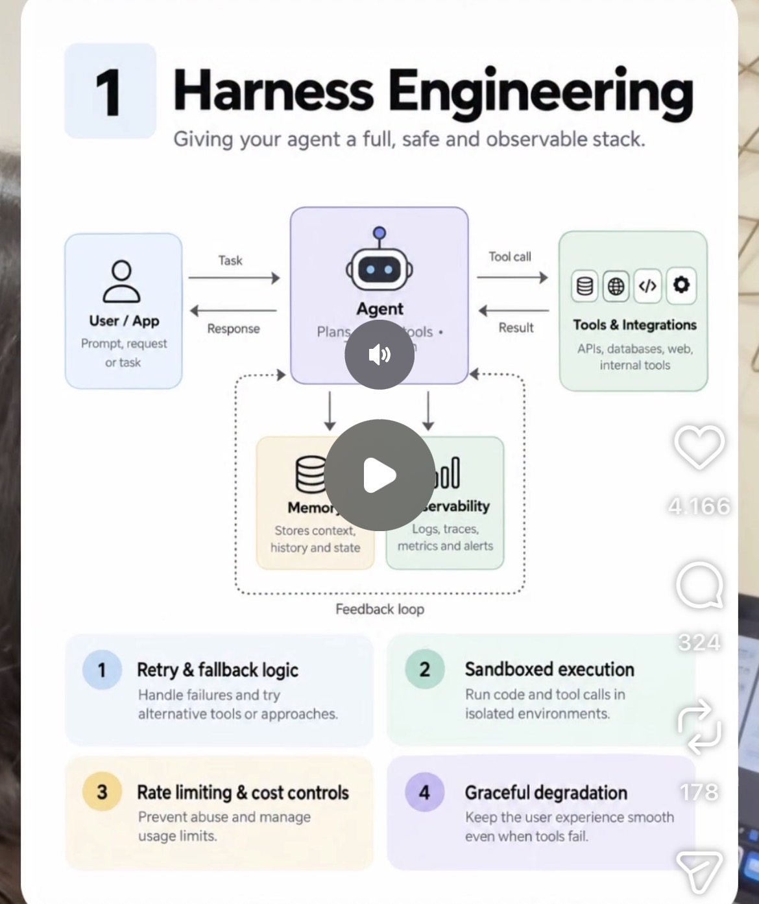

# 01 · Harness Engineering

**Goal:** Give your agent a safe, observable stack with retries, sandboxing and cost limits so it doesn't spiral out of control.

**Time:** 7 h

## Key concepts

- Sandbox: isolate code, file and network access
- Retry and fallback logic for transient failures
- Cost and token budgets per run
- Monitoring: logs, traces, alerts and dashboards
- Agent core = LLM + planner + memory + tools inside a controlled runtime

## Learn

- [ ] [Building effective agents (Anthropic)](https://www.anthropic.com/research/building-effective-agents) — article, ~30 min
- [ ] [Effective harnesses for long-running agents (Anthropic)](https://www.anthropic.com/research/effective-harnesses-for-long-running-agents) — article, ~25 min
- [ ] [Harness design for long-running application development (Anthropic)](https://www.anthropic.com/research/harness-design-long-running-apps) — article, ~25 min
- [ ] [Scaling Managed Agents: decoupling the brain from the hands (Anthropic)](https://www.anthropic.com/research/managed-agents) — article, ~20 min
- [ ] [Hugging Face AI Agents Course, Unit 1 (free, certificate)](https://huggingface.co/learn/agents-course) — course, ~3 h
- [ ] [YouTube: Barry Zhang, 'How we build effective agents' (AI Engineer Summit)](https://www.youtube.com/results?search_query=Barry+Zhang+how+we+build+effective+agents+Anthropic) — video, ~20 min

## Build step

- [ ] Scaffold the repo: Dockerfile, a run loop that calls Claude with one dummy tool, a hard token/cost ceiling per run, exponential-backoff retries on 429/5xx, and tool code running in a locked-down container (no network, read-only FS).

**Done when:** A run that exceeds its budget stops cleanly with a logged reason; a forced API error is retried and recovered.
