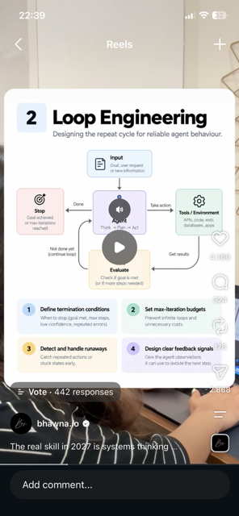

# 02 · Loop Engineering

**Goal:** Design how the agent repeats actions, checks its own progress and knows when to stop instead of looping forever.

**Time:** 5 h

## Key concepts

- Think → Plan → Act → Evaluate cycle
- Termination conditions: goal met, max steps, low confidence, repeated errors
- Max-iteration budgets
- Detecting runaways: repeated actions, stuck states
- Clear feedback signals from tool results

## Learn

- [ ] [12-Factor Agents (HumanLayer), esp. factor 8: own your control flow](https://github.com/humanlayer/12-factor-agents) — article, ~45 min
- [ ] [The 'think' tool (Anthropic)](https://www.anthropic.com/research/claude-think-tool) — article, ~15 min
- [ ] [Agents, by Chip Huyen (planning, reflection, failure modes)](https://huyenchip.com/2025/01/07/agents.html) — article, ~45 min
- [ ] [DeepLearning.AI: AI Agents in LangGraph (short course)](https://www.deeplearning.ai/short-courses/ai-agents-in-langgraph/) — course, ~1.5 h
- [ ] [YouTube: Dex Horthy, '12-Factor Agents' talk](https://www.youtube.com/results?search_query=Dex+Horthy+12+factor+agents) — video, ~20 min

## Build step

- [ ] Write the agent loop yourself (no framework): explicit state object, max_steps, a 'same tool + same args 3x' runaway detector, and a final 'done / gave up / needs human' status.

**Done when:** You can show three runs that end for three different, logged reasons.
