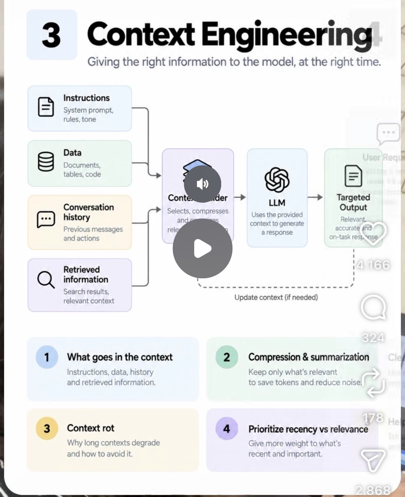

# 03 · Context Engineering

**Goal:** Feed the model the right information at the right time. Too much context rots, too little breaks the response.

**Time:** 8 h

## Key concepts

- System prompt, task, retrieved docs, history and tool results as separate context layers
- Retrieval (RAG) vs. stuffing
- Compaction and summarisation of long histories
- Just-in-time loading (skills, file references)
- Context rot and the 'lost in the middle' effect

## Learn

- [ ] [Effective context engineering for AI agents (Anthropic)](https://www.anthropic.com/research/effective-context-engineering-for-ai-agents) — article, ~25 min
- [ ] [Equipping agents for the real world with Agent Skills (Anthropic)](https://www.anthropic.com/research/equipping-agents-for-the-real-world-with-agent-skills) — article, ~15 min
- [ ] [Code execution with MCP: building more efficient agents (Anthropic)](https://www.anthropic.com/research/code-execution-with-mcp) — article, ~15 min
- [ ] [Context Engineering for AI Agents: lessons from building Manus](https://manus.im/blog/Context-Engineering-for-AI-Agents-Lessons-from-Building-Manus) — article, ~25 min
- [ ] [Context Engineering for Agents, by Lance Martin](https://rlancemartin.github.io/2025/06/23/context_engineering/) — article, ~25 min
- [ ] [YouTube: Context engineering for agents (Lance Martin / LangChain)](https://www.youtube.com/results?search_query=Lance+Martin+context+engineering+for+agents) — video, ~30 min

## Build step

- [ ] Add policy-document retrieval (reuse your existing RAG know-how), a context builder that assembles layers in a fixed order, and history compaction once the transcript passes a token threshold.

**Done when:** A 30-turn conversation stays under your token budget and still answers a question about turn 2 correctly.
