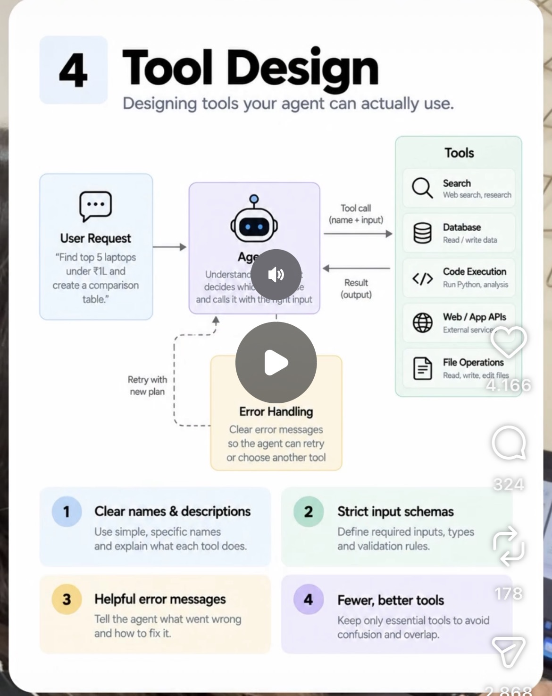

# 04 · Tool Design

**Goal:** Build tools the agent can actually use correctly, with clear names, strict input schemas and error handling it can recover from.

**Time:** 8 h

## Key concepts

- Clear, specific names and descriptions
- Strict JSON input schemas, validated before execution
- Helpful, structured error messages
- Few, high-level tools instead of many thin API wrappers
- Token-efficient outputs; MCP as the standard interface

## Learn

- [ ] [Writing effective tools for agents, with agents (Anthropic)](https://www.anthropic.com/research/writing-tools-for-agents) — article, ~25 min
- [ ] [Introducing advanced tool use on the Claude Developer Platform](https://www.anthropic.com/research/advanced-tool-use) — article, ~15 min
- [ ] [Claude docs: Tool use overview](https://docs.claude.com/en/docs/agents-and-tools/tool-use/overview) — docs, ~45 min
- [ ] [Model Context Protocol: official docs](https://modelcontextprotocol.io/) — docs, ~1 h
- [ ] [DeepLearning.AI: MCP, Build Rich-Context AI Apps with Anthropic](https://www.deeplearning.ai/short-courses/mcp-build-rich-context-ai-apps-with-anthropic/) — course, ~1.7 h
- [ ] [Anthropic Academy (free): Introduction to MCP, Building with the Claude API](https://anthropic.skilljar.com/) — course, ~3 h

## Build step

- [ ] Expose three tools as an MCP server: lookup_policy(policy_id), check_coverage(policy_id, incident_type, date), create_claim_draft(...). Pydantic-validated inputs, errors that tell the model what to fix.

**Done when:** Feed deliberately bad arguments; the agent reads your error message and corrects itself on the next call.
