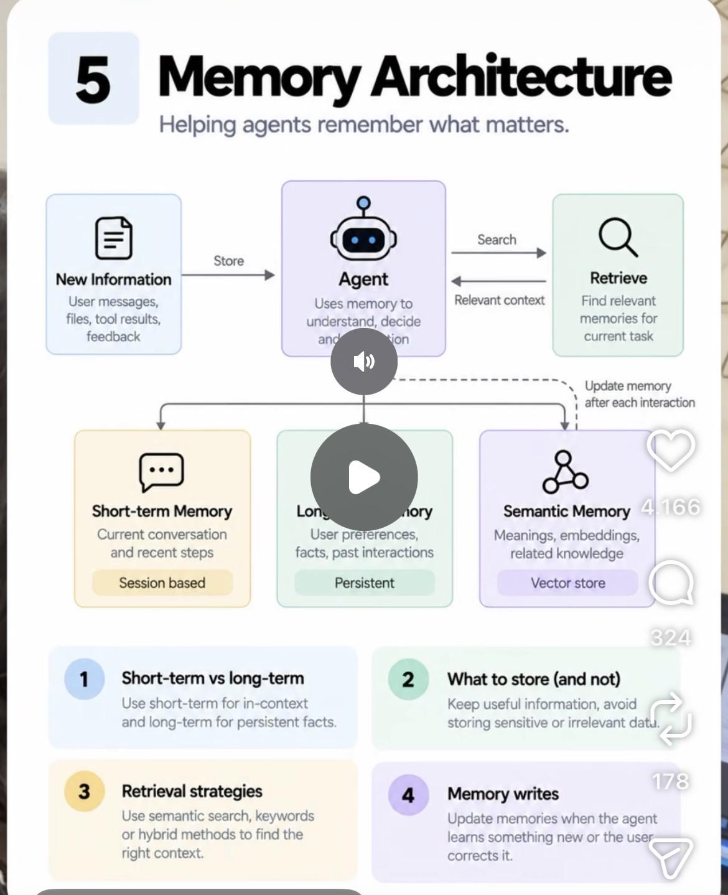

# 05 · Memory Architecture

**Goal:** Help the agent remember what matters using short-term, long-term and semantic memory instead of dumping everything into one context window.

**Time:** 8 h

## Key concepts

- Short-term (working) memory: current session
- Long-term memory: facts and preferences across sessions
- Semantic memory: vector search over knowledge
- Writing: what to store, when, and how to update or forget
- Retrieval: relevant memories pulled back into context

## Learn

- [ ] [DeepLearning.AI: LLMs as Operating Systems, Agent Memory (Letta)](https://www.deeplearning.ai/short-courses/llms-as-operating-systems-agent-memory/) — course, ~1.5 h
- [ ] [DeepLearning.AI: Long-Term Agentic Memory with LangGraph](https://www.deeplearning.ai/short-courses/long-term-agentic-memory-with-langgraph/) — course, ~1.2 h
- [ ] [Claude docs: Memory tool](https://docs.claude.com/en/docs/agents-and-tools/tool-use/memory-tool) — docs, ~20 min
- [ ] [Letta (MemGPT) documentation](https://docs.letta.com/) — docs, ~40 min
- [ ] [mem0: open-source memory layer (GitHub)](https://github.com/mem0ai/mem0) — docs, ~30 min
- [ ] [YouTube: Charles Packer on MemGPT / agent memory](https://www.youtube.com/results?search_query=Charles+Packer+MemGPT+agent+memory) — video, ~30 min

## Build step

- [ ] Add a per-customer memory store (SQLite + embeddings, e.g. pgvector or Chroma in Docker): remember prior claims and preferred language, with an explicit 'forget' path (GDPR right to erasure).

**Done when:** A new session recalls a fact from a previous one, and a forget request removes it from both stores.
