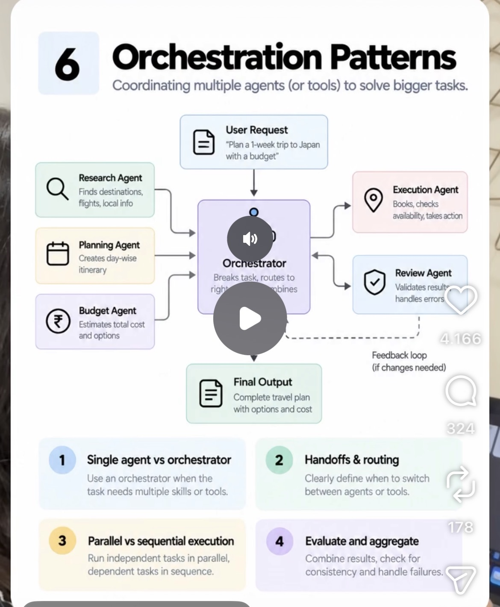

# 06 · Orchestration Patterns

**Goal:** Coordinate multiple agents so they split tasks, hand off work and combine results without stepping on each other.

**Time:** 8 h

## Key concepts

- Orchestrator–worker (supervisor) pattern
- Sequential pipelines and parallel fan-out
- Handoffs with clear contracts
- Shared state vs. isolated sub-agent context
- When one agent is enough (cost of multi-agent)

## Learn

- [ ] [How we built our multi-agent research system (Anthropic)](https://www.anthropic.com/research/multi-agent-research-system) — article, ~30 min
- [ ] [Building a C compiler with a team of parallel Claudes (Anthropic)](https://www.anthropic.com/research/building-c-compiler) — article, ~25 min
- [ ] [LangChain Academy: Introduction to LangGraph (free)](https://academy.langchain.com/courses/intro-to-langgraph) — course, ~6 h
- [ ] [DeepLearning.AI: Multi AI Agent Systems with crewAI](https://www.deeplearning.ai/short-courses/multi-ai-agent-systems-with-crewai/) — course, ~2.7 h
- [ ] [OpenAI Agents SDK docs: handoffs, guardrails, tracing (good pattern reference)](https://openai.github.io/openai-agents-python/) — docs, ~40 min

## Build step

- [ ] Split the agent: an orchestrator routes to a Policy-QA worker and a Claim-Intake worker running in parallel where possible; each worker gets only its own context and returns a typed result.

**Done when:** A mixed request ('Am I covered, and file the claim') is split, run in parallel and merged into one answer.
