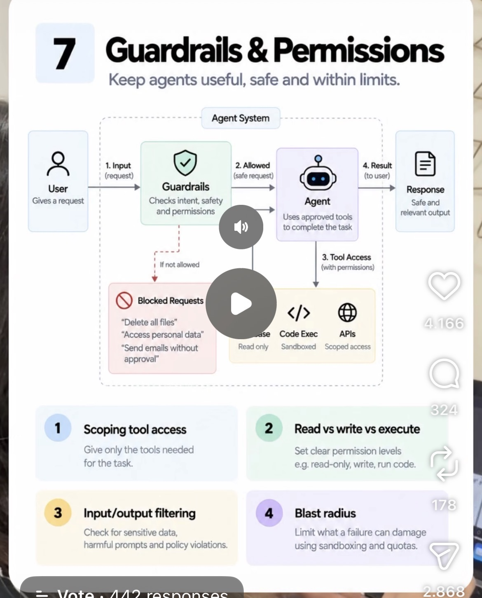

# 07 · Guardrails & Permissions

**Goal:** Keep the agent useful but safe by scoping which tools it can touch and limiting the blast radius if something goes wrong.

**Time:** 7 h

## Key concepts

- Input guardrails: validate, sanitise, detect prompt injection
- Output guardrails: PII, policy and format checks
- Least-privilege tool permissions and allowlists
- Sandboxing and network egress control
- Audit logs for every privileged action

## Learn

- [ ] [Beyond permission prompts: making Claude Code more secure and autonomous](https://www.anthropic.com/research/claude-code-sandboxing) — article, ~20 min
- [ ] [How we contain Claude across products (Anthropic)](https://www.anthropic.com/research/how-we-contain-claude) — article, ~20 min
- [ ] [How we built Claude Code auto mode: a safer way to skip permissions](https://www.anthropic.com/research/claude-code-auto-mode) — article, ~20 min
- [ ] [OWASP Top 10 for LLM Applications](https://genai.owasp.org/llm-top-10/) — docs, ~1 h
- [ ] [DeepLearning.AI: Safe and Reliable AI via Guardrails](https://www.deeplearning.ai/short-courses/safe-and-reliable-ai-via-guardrails/) — course, ~1.7 h
- [ ] [YouTube: Simon Willison on prompt injection](https://www.youtube.com/results?search_query=Simon+Willison+prompt+injection) — video, ~40 min

## Build step

- [ ] Add a permission matrix (read-only tools free, create_claim_draft gated), a PII redaction pass on outputs, an injection test set hidden inside a 'policy PDF', and a Kubernetes NetworkPolicy that blocks tool-container egress.

**Done when:** Your injection test cannot make the agent call a gated tool, and every privileged call shows up in the audit log.
