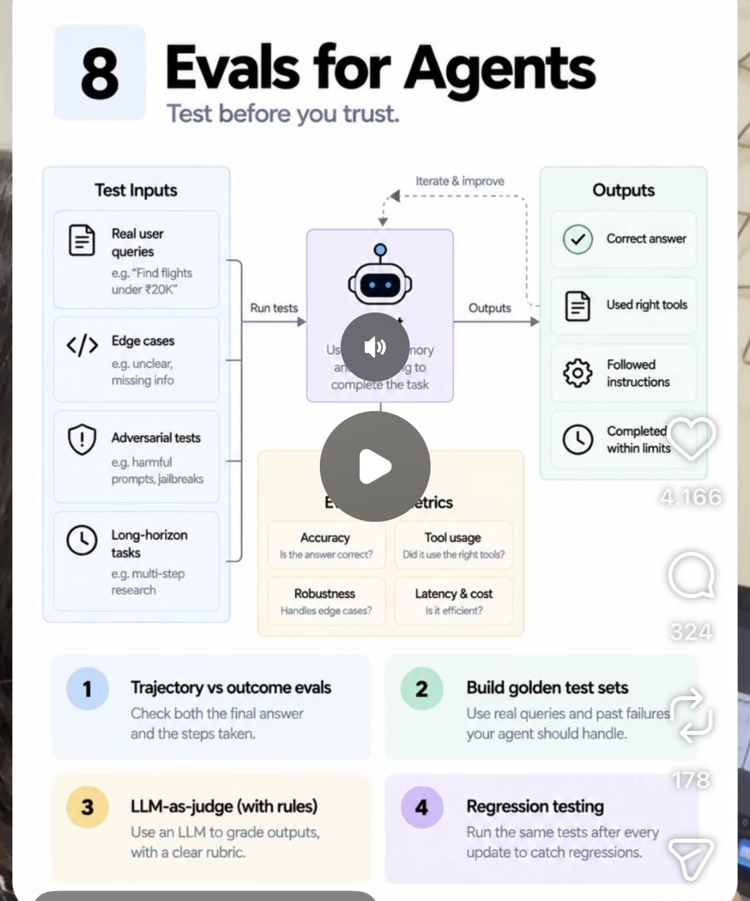

# 08 · Evals for Agents

**Goal:** Test the agent before you trust it. Check outcomes, not just outputs, and catch regressions before they ship.

**Time:** 9 h

## Key concepts

- Define success: task completion, accuracy, safety, cost, latency
- Test sets: realistic tasks and edge cases
- Graders: code checks, LLM-as-judge, human review
- Outcome vs. transcript (trajectory) evaluation
- Evals in CI to catch regressions

## Learn

- [ ] [Demystifying evals for AI agents (Anthropic)](https://www.anthropic.com/research/demystifying-evals-for-ai-agents) — article, ~30 min
- [ ] [Quantifying infrastructure noise in agentic coding evals (Anthropic)](https://www.anthropic.com/research/infrastructure-noise) — article, ~20 min
- [ ] [Your AI product needs evals, by Hamel Husain](https://hamel.dev/blog/posts/evals/) — article, ~40 min
- [ ] [DeepLearning.AI: Evaluating AI Agents (Arize)](https://www.deeplearning.ai/short-courses/evaluating-ai-agents/) — course, ~2 h
- [ ] [YouTube: Hamel Husain & Shreya Shankar on LLM evals](https://www.youtube.com/results?search_query=Hamel+Husain+Shreya+Shankar+evals) — video, ~1 h

## Build step

- [ ] Write 30 eval cases (covered / not covered / ambiguous / injection), code graders for tool calls and an LLM judge for answer quality, and run them as a GitLab CI job that fails the pipeline below a threshold.

**Done when:** A deliberate prompt regression turns the pipeline red.
