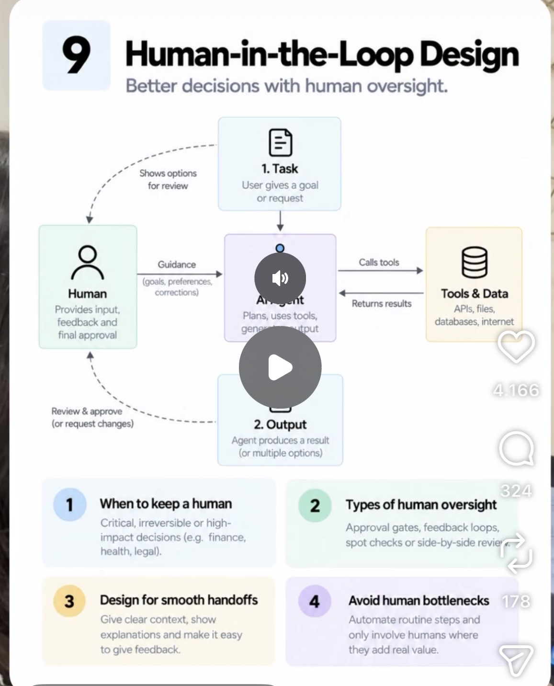

# 09 · Human-in-the-Loop Design

**Goal:** Know exactly when a human should step in for approval, and when the agent should just run.

**Time:** 5 h

## Key concepts

- When to keep a human: critical, irreversible or high-impact decisions (finance, health, legal)
- Types of oversight: approval gates, feedback loops, spot checks, side-by-side review
- Smooth handoffs: clear context and explanations
- Avoid human bottlenecks: automate routine steps

## Learn

- [ ] [12-Factor Agents, factor 7: contact humans with tool calls](https://github.com/humanlayer/12-factor-agents) — article, ~15 min
- [ ] [LangChain Academy: Introduction to LangGraph, human-in-the-loop module](https://academy.langchain.com/courses/intro-to-langgraph) — course, ~1.5 h
- [ ] [Claude Code auto mode (how approval gates are decided)](https://www.anthropic.com/research/claude-code-auto-mode) — article, ~20 min
- [ ] [HumanLayer: approvals for agent tool calls (GitHub)](https://github.com/humanlayer/humanlayer) — docs, ~30 min
- [ ] [YouTube: LangGraph human-in-the-loop with interrupts](https://www.youtube.com/results?search_query=LangGraph+human+in+the+loop+interrupt) — video, ~20 min

## Build step

- [ ] Before create_claim_draft runs above €1,000 or with low confidence, pause, send the summary to Telegram (as in your Gmail agent) and resume on approve / edit / reject.

**Done when:** A rejected draft returns to the agent with the reviewer's note and is revised, without restarting the run.
