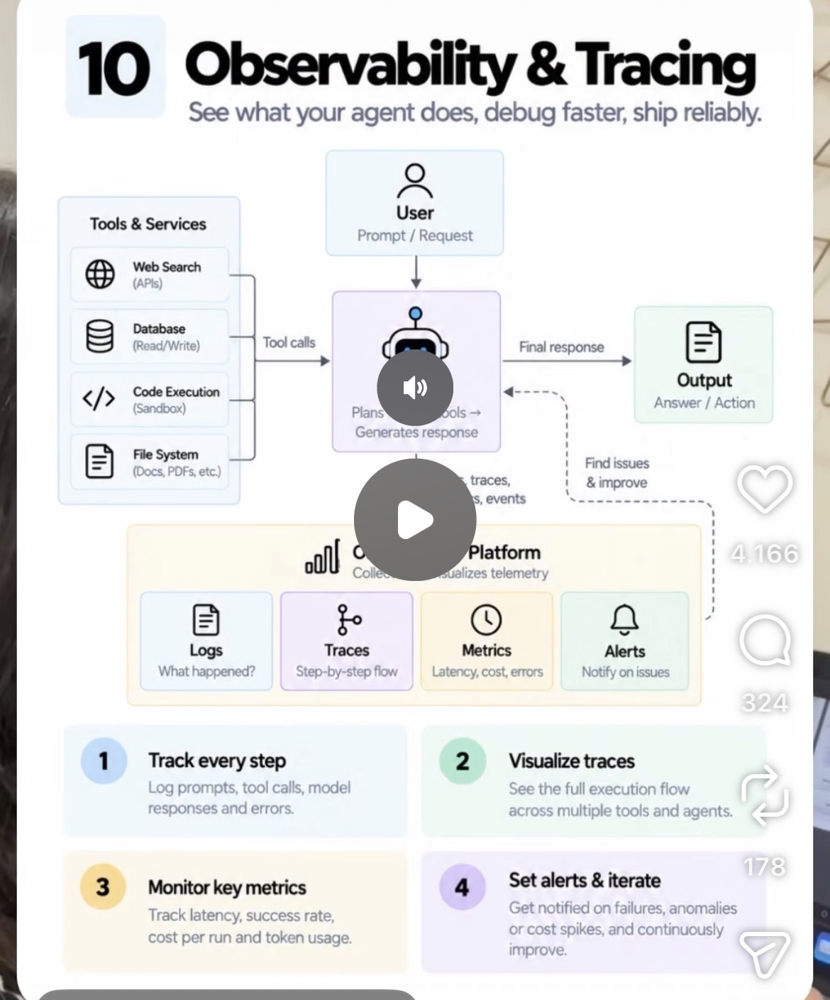

# 10 · Observability & Tracing

**Goal:** See every step the agent takes so you can debug fast and ship with confidence instead of guessing.

**Time:** 7 h

## Key concepts

- Track every step: prompts, tool calls, responses, errors
- Visualise traces across tools and agents
- Key metrics: latency, success rate, cost per run, token usage
- Alerts on failures, anomalies and cost spikes
- OpenTelemetry GenAI conventions

## Learn

- [ ] [Langfuse docs (open source, self-hostable with Docker)](https://langfuse.com/docs) — docs, ~1 h
- [ ] [Arize Phoenix docs (open-source tracing and evals)](https://docs.arize.com/phoenix) — docs, ~45 min
- [ ] [OpenTelemetry semantic conventions for generative AI](https://opentelemetry.io/docs/specs/semconv/gen-ai/) — docs, ~30 min
- [ ] [An update on recent Claude Code quality reports (a real debugging postmortem)](https://www.anthropic.com/research/april-23-postmortem) — article, ~15 min
- [ ] [YouTube: Langfuse tracing tutorial](https://www.youtube.com/results?search_query=Langfuse+tracing+tutorial+agents) — video, ~30 min

## Build step

- [ ] Self-host Langfuse in Docker (later Helm on your cluster), trace every model and tool call with run IDs, build a cost-per-run and success-rate dashboard, and alert when a run costs over 3x the median.

**Done when:** You can open any failed eval case from week 8 and see exactly which step went wrong.
